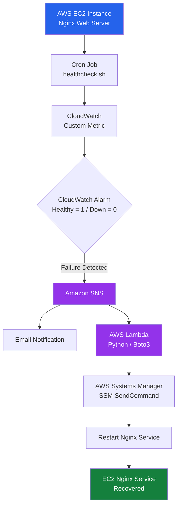

# 🚀 Self-Healing EC2 Infrastructure on AWS

Automated failure detection and self-recovery for an Nginx web server running on AWS EC2 using **Amazon CloudWatch, SNS, AWS Lambda, and Systems Manager (SSM)**.

This project demonstrates how to build a self-healing infrastructure that detects service failures, automatically restarts the failed service, and sends email notifications without requiring manual intervention.

## 📌 Problem Statement

Servers and applications can fail unexpectedly. Manually identifying failures and restarting services can increase downtime and requires continuous human monitoring.

This project solves that problem by implementing automated monitoring, failure detection, alerting, and recovery using AWS services.

## 🏗️ Architecture



### Architecture Components

| AWS Service | Purpose |
|---|---|
| EC2 | Hosts the Nginx web server |
| Cron | Executes health checks every minute |
| CloudWatch | Collects custom health metrics |
| CloudWatch Alarm | Detects service failures |
| SNS | Sends notifications and triggers Lambda |
| Lambda | Executes automated recovery logic |
| Systems Manager (SSM) | Remotely executes restart commands |
| IAM | Provides secure permissions |

## ⚙️ How It Works

1. **Health Monitoring:** A Bash script (`healthcheck.sh`) runs every minute through cron and checks whether Nginx is running.
2. **Metric Publishing:** The script sends a custom CloudWatch metric:
   - `1` = Nginx is healthy.
   - `0` = Nginx is down.
3. **Failure Detection:** CloudWatch Alarm monitors the metric and triggers when two consecutive checks report failure.
4. **SNS Notification:** CloudWatch publishes an alarm notification to an SNS topic.
5. **Lambda Execution:** SNS invokes the Python Lambda function.
6. **Automated Recovery:** Lambda uses AWS Systems Manager (SSM) to execute a command on the EC2 instance and restart Nginx.
7. **Email Alert:** SNS sends an email notification about the failure.

## 🛠️ Technologies Used

- AWS EC2
- Amazon CloudWatch
- Amazon SNS
- AWS Lambda
- AWS Systems Manager (SSM)
- AWS IAM
- Linux / Ubuntu
- Bash Scripting
- Python
- Boto3
- Cron Jobs

## 📂 Project Structure

```text
self-healing-ec2-nginx/
│
├── README.md
├── healthcheck.sh
└── lambda_function.py
```

### Important Files

**1. healthcheck.sh**

- Checks Nginx service status.
- Publishes custom metrics to CloudWatch.
- Runs automatically through cron.

**2. lambda_function.py**

- Receives SNS-triggered events.
- Uses Boto3 to communicate with AWS Systems Manager.
- Executes the Nginx restart command on EC2.

## 🔐 Security Implementation

- IAM roles for EC2 and Lambda.
- EC2 uses Systems Manager instead of SSH keys for remote remediation.
- Lambda receives only the permissions required to execute SSM commands.
- IAM policies follow the principle of least privilege.

## 🎯 Key Learning Outcomes

- Automated infrastructure monitoring.
- CloudWatch custom metrics and alarms.
- Event-driven automation using SNS and Lambda.
- Remote command execution using AWS Systems Manager.
- Linux Bash scripting and cron scheduling.
- IAM roles and permissions.
- Building self-healing cloud infrastructure.

## 🚀 Future Improvements

- Integrate Auto Scaling Groups to replace unhealthy EC2 instances.
- Add Slack notifications.
- Monitor multiple services.
- Create Grafana dashboards for monitoring.
- Integrate Prometheus for advanced observability.

## 👨‍💻 Author

**Nikhil Thakare**

Aspiring DevOps Engineer | AWS | Linux | Docker | Kubernetes | Terraform | Jenkins

GitHub: [Nikhilthakare2389](https://github.com/Nikhilthakare2389)

---

 If you find this project useful, feel free to explore the repository and share your feedback.
