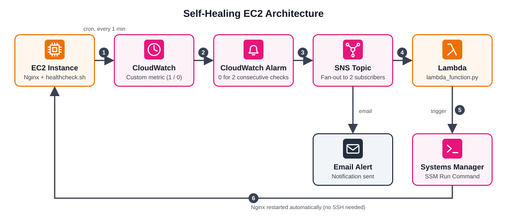

# Self-Healing EC2 Infrastructure

This project monitors an Nginx service running on an AWS EC2 instance. If the service stops, the system detects the failure and attempts to restart Nginx automatically.

## Architecture

## How it works

1. A Bash health-check script (`healthcheck.sh`) runs every minute through cron and checks whether Nginx is active.
2. The script publishes a custom metric to CloudWatch: `1` when Nginx is running and `0` when it is down.
3. A CloudWatch Alarm monitors the metric and triggers after two consecutive failed checks.
4. The alarm publishes a message to an SNS topic. SNS sends an email notification and invokes the Lambda function.
5. The Lambda function (`lambda_function.py`) uses AWS Systems Manager (SSM) to send a command to the EC2 instance.
6. SSM runs the command to restart Nginx.

## AWS services and tools

- Amazon EC2
- Amazon CloudWatch
- Amazon SNS
- AWS Lambda
- AWS Systems Manager (SSM)
- AWS IAM
- Bash and cron
- Python and Boto3

## Project files

- `healthcheck.sh` – checks the Nginx service and publishes its status to CloudWatch.
- `lambda_function.py` – handles the recovery action by sending a command through SSM.
- `architecture.svg` – architecture diagram displayed above.

## What I worked on

- Monitoring a Linux service with a Bash script.
- Sending custom metrics to CloudWatch.
- Configuring an alarm for failed health checks.
- Connecting CloudWatch alarms to SNS and Lambda.
- Using Systems Manager to run a recovery command on EC2.
- Setting up the IAM permissions needed for the workflow.

## Possible next steps

- Use an Auto Scaling Group to replace an unhealthy EC2 instance.
- Add Slack notifications.
- Extend the health check to cover more services.
